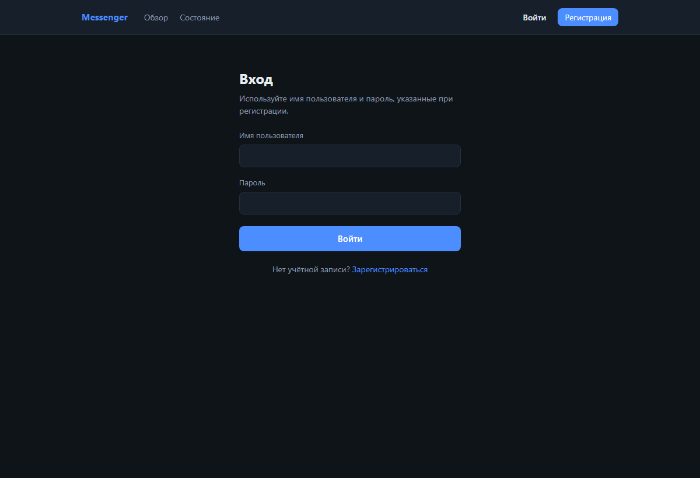
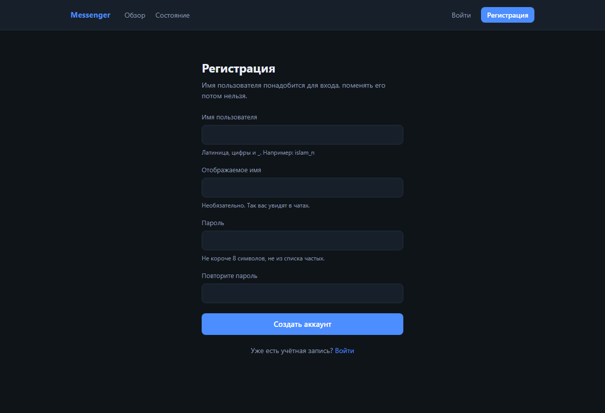
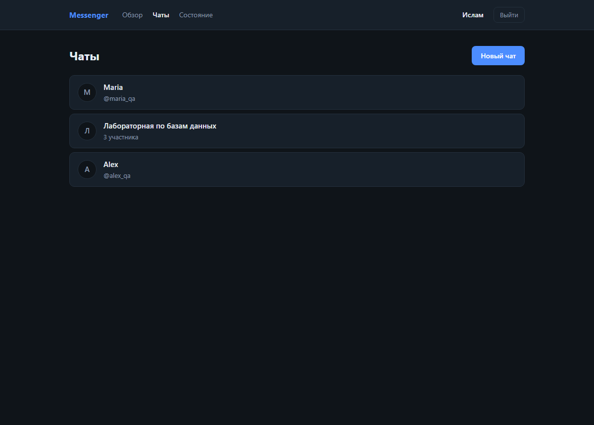
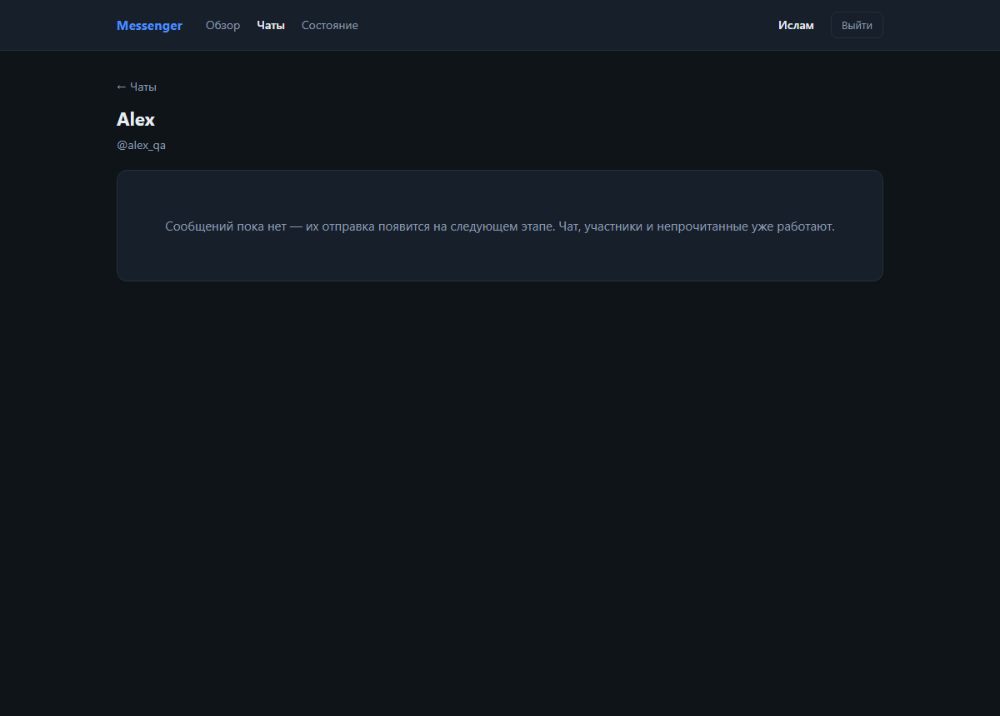
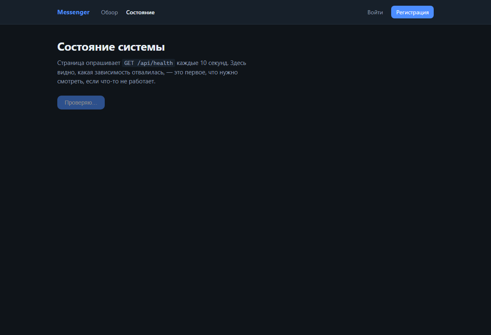

# Messenger

Учебный мессенджер: личные сообщения, группы и каналы. Веб на SvelteKit, десктоп на
Electron, мобильное приложение на Flutter. Бэкенд — Django + PostgreSQL, доставка в
реальном времени — Centrifugo, полнотекстовый поиск — Elasticsearch.

Репозиторий: <https://github.com/islamnurullin/messenger>. Статус CI:
[](https://github.com/islamnurullin/messenger/actions/workflows/ci.yml)

> **Статус: этап 3 из 12 — выполнен.** Работают инфраструктура, health-check,
> аккаунты и чаты: личные диалоги, группы, участники, счётчик непрочитанных.
> Самих сообщений пока нет: дальше этап 4 «Сообщения».

| Вход | Регистрация |
|---|---|
|  |  |

| Список чатов | Чат |
|---|---|
|  |  |



## Что уже работает

- Инфраструктура поднимается одной командой (PostgreSQL, Redis, Centrifugo).
- `GET /api/health` проверяет каждую зависимость отдельно и отдаёт `ok` / `degraded` /
  `unavailable` — по нему видно, что именно отвалилось.
- Веб-интерфейс показывает состояние системы на странице `/status`.
- Регистрация и вход по логину и паролю (без телефона), JWT с автопродлением
  токена — пользователь не вылетает посреди работы.
- Профиль: имя, описание, аватар (сжимается до 256×256 на сервере), видна дата
  последнего визита.
- Чаты: личный диалог по имени пользователя (повторное открытие возвращает тот же
  чат, дублей нет), группы с участниками, счётчик непрочитанных
  (`last_seq - last_read_seq`), отметка о прочтении.

## Требования

| Инструмент | Версия | Зачем |
|---|---|---|
| Python | 3.12+ | бэкенд |
| Node.js | 22+ | веб и десктоп |
| Docker Desktop | 4.x+ | PostgreSQL, Redis, Centrifugo, Elasticsearch |
| Git | 2.40+ | версии |
| PowerShell | 7+ | скрипты `scripts/*.ps1` |

Flutter и Android SDK понадобятся только на этапе мобильного клиента — сейчас их можно
не ставить.

> **PowerShell 7 нужен именно как `pwsh`.** В Windows есть 5.1 (`powershell.exe`), но в
> `%LOCALAPPDATA%\Microsoft\WindowsApps` может лежать 0-байтная заглушка `pwsh.exe`,
> которая не запускается. Установка: `winget install --id Microsoft.PowerShell -e`.

## Быстрый старт

```bash
git clone https://github.com/islamnurullin/messenger.git
cd messenger
cp .env.example .env
```

> Первый запуск на Windows одной командой: `.\scripts\setup.ps1`. Скрипт создаёт venv,
> ставит зависимости, поднимает Docker и применяет миграции. Пошагово —
> [docs/getting-started.md](docs/getting-started.md). Если что-то не запускается —
> [docs/troubleshooting.md](docs/troubleshooting.md).

### 1. Инфраструктура

```bash
docker compose -f infra/docker-compose.yml up -d
```

Поднимаются три сервиса: PostgreSQL (`5433` на хосте), Redis (`6379`), Centrifugo (`8001`).
Elasticsearch вынесен в отдельный профиль, потому что ест ~1.5 ГБ RAM:

```bash
docker compose -f infra/docker-compose.yml --profile search up -d
```

> **Почему PostgreSQL на 5433, а не на 5432.** На Windows часто уже работает нативная
> служба `postgresql-x64-*` (ставится вместе с pgAdmin или другими курсовыми), и она
> занимает 5432. Docker тогда не может опубликовать порт, а Django подключается к чужой
> базе и падает с невнятной ошибкой. Если 5432 свободен, можно вернуть стандартный порт
> через `POSTGRES_HOST_PORT=5432` и `POSTGRES_PORT=5432` в `.env`.

### 2. Бэкенд

```bash
cd backend
python -m venv .venv
source .venv/Scripts/activate      # Windows (PowerShell: .venv\Scripts\Activate.ps1)
# source .venv/bin/activate        # macOS / Linux
pip install -r requirements-dev.txt
python manage.py migrate
python manage.py createsuperuser
python manage.py runserver
```

API — http://127.0.0.1:8000, админка — http://127.0.0.1:8000/admin/.

### 3. Веб

```bash
cd web
npm install
npm run dev
```

Интерфейс — http://localhost:5173.

### Проверка, что всё сошлось

```bash
curl http://127.0.0.1:8000/api/health
```

```json
{
  "status": "ok",
  "checks": {
    "database": { "status": "ok", "latency_ms": 45.5 },
    "redis": { "status": "ok", "latency_ms": 281.4 },
    "centrifugo": { "status": "ok", "latency_ms": 1194.18, "nodes": 1, "version": "6.10.2 OSS" },
    "elasticsearch": { "status": "disabled" }
  }
}
```

Если `status` — `degraded`, значит живы БД и Redis, но не отвечает Centrifugo или поиск:
приложение работает, доставка в реальном времени — нет. `unavailable` и код 503 означают,
что лежит БД или Redis.

> Centrifugo проверяется через `POST /api` с методом `info`, а не через `GET /health`:
> в Centrifugo v6 такого эндпоинта нет, и запрос к нему всегда возвращает 404. Подробнее —
> [docs/troubleshooting.md](docs/troubleshooting.md#особый-случай-centrifugo-живой-но-проверка-даёт-404).

## Аккаунты и API

| Метод | Путь | Что делает |
|---|---|---|
| `POST` | `/api/auth/register` | регистрация: логин, пароль, имя → токены |
| `POST` | `/api/auth/login` | вход → `access` (15 мин) и `refresh` (30 дней) |
| `POST` | `/api/auth/refresh` | новый `access` по `refresh` |
| `GET` | `/api/me` | свой профиль |
| `PATCH` | `/api/me` | имя, описание, аватар (multipart) |

Логин — `^[A-Za-z0-9_]{3,32}$`, проверяется без учёта регистра: `Islam` и `islam` —
одно имя. Пароль проходит валидаторы Django (минимум 8 символов). Токены браузер
хранит в `localStorage` и продлевает сам при ответе 401 — обоснование в
[ADR 0004](docs/adr/0004-jwt-storage.md).

```bash
curl -X POST http://127.0.0.1:8000/api/auth/register \
  -H 'Content-Type: application/json' \
  -d '{"username":"islam","password":"mnogo-bukv-2026","display_name":"Ислам"}'
```

Аватар: JPEG, PNG или WebP до 25 МБ. Сервер сам обрезает по центру квадрат и
уменьшает до 256×256 — клиент может отправить фото прямо с телефона.

## Чаты и API

| Метод | Путь | Что делает |
|---|---|---|
| `GET` | `/api/chats` | мои чаты с непрочитанными |
| `POST` | `/api/chats` | создать личный чат (`{"type":"direct","username":"alice"}`) или группу |
| `GET` | `/api/chats/{id}` | один чат |
| `GET` | `/api/chats/{id}/members` | участники |
| `POST` | `/api/chats/{id}/members` | добавить участника (только группа/канал) |
| `POST` | `/api/chats/{id}/read` | отметить прочитанным до `seq` |

Личный чат идемпотентен: повторный запрос с тем же собеседником (с любой стороны)
возвращает существующий чат со статусом 200 вместо создания нового. Это держится
на уникальном индексе `direct_key = "меньший_id:больший_id"`, а не на проверке в
коде — проверка не спасает от гонки двух одновременных запросов.

Не-участник получает **404, а не 403**: 403 подтвердил бы существование чата, и
перебором id можно было бы узнать о чужих переписках.

Непрочитанные считаются как `last_seq - last_read_seq` на сервере. Отметка о
прочтении монотонна и не может превысить `last_seq` — устаревший или завышенный
`seq` от клиента не сломает счётчик.

## Структура репозитория

```
backend/          Django: REST API, модели, Celery-задачи
  apps/
    accounts/     пользователи, аутентификация
    chats/        чаты и участники
    messaging/    сообщения
    realtime/     выдача токенов и публикация в Centrifugo
    search/       индексация в Elasticsearch
    common/       health-check, общий формат ошибок
  config/         настройки, urls, celery, asgi
web/              SvelteKit: веб-клиент
infra/            docker-compose и конфиг Centrifugo
docs/adr/         архитектурные решения
PLAN.md           план проекта по этапам
SPEC.md           техническое задание
```

## Разработка

### Ветки

- `main` — то, что сдаётся. Только через merge из `develop`.
- `develop` — интеграционная ветка.
- `feature/<тема>` — задачи. Ветвится от `develop`, вливается обратно через PR.

Коммиты — в формате [Conventional Commits](https://www.conventionalcommits.org/):
`feat:`, `fix:`, `docs:`, `refactor:`, `test:`, `chore:`.

### Тесты и линтеры

```bash
# бэкенд
cd backend
pytest
ruff check .
ruff format --check .

# веб
cd web
npm run check
npm run lint
```

## Архитектурные решения

Ключевые решения и причины, по которым они приняты, — в [`docs/adr/`](docs/adr/):

- [0001 — выбор стека](docs/adr/0001-stack.md)
- [0002 — монотонный `seq` вместо сортировки по времени](docs/adr/0002-monotonic-seq.md)
- [0003 — порядок записи и публикации сообщения](docs/adr/0003-write-then-publish.md)
- [0004 — где хранится JWT](docs/adr/0004-jwt-storage.md)

## Лицензия

Учебный проект, лицензия не задана.
